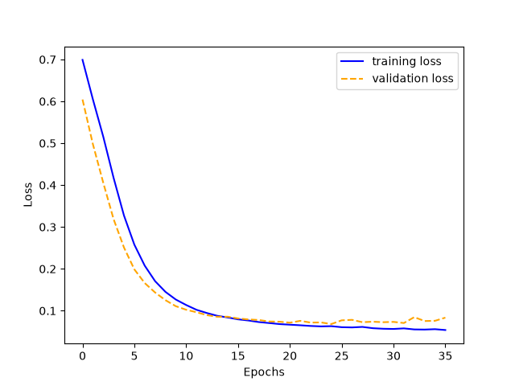
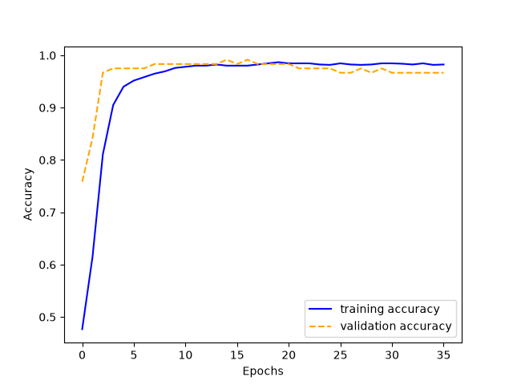
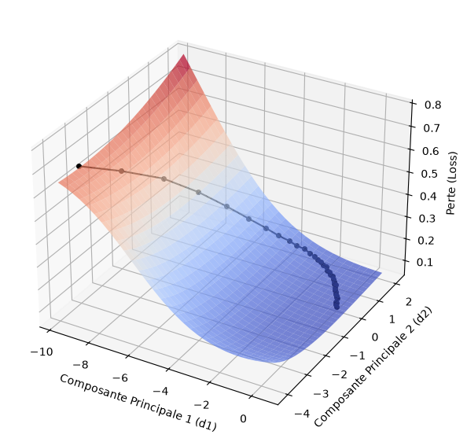

# Multilayer Perceptron (MLP) From Scratch

[](https://www.python.org/)
[](https://numpy.org/)
[](http://mypy-lang.org/)
[](https://42.fr/)

A fully vectorized, production-grade Multilayer Perceptron implemented from first mathematical principles using pure NumPy. Features a modular PyTorch-like architecture, analytical backpropagation engine, extensible optimizer strategy pattern (SGD & Adam), and 3D loss surface topology analysis via SVD parameter projection.

---

## 📌 Academic & Constraints Context

This project is part of the **42 School AI / Data Science curriculum**. The objective is to construct a deep learning classification system from scratch to diagnose breast cancer tumors using the **Wisconsin Diagnostic Breast Cancer (WDBC)** dataset (569 instances, 30 continuous real-valued features per cell nucleus).

### Non-Negotiable Engineering Constraints
- **Zero High-Level Deep Learning Frameworks**: Complete ban on PyTorch, TensorFlow, Keras, Scikit-learn, and Autograd.
- **Pure NumPy Vectorization**: All linear transformations, chain-rule gradient backpropagations, batch scheduling, and optimization passes must be implemented purely through matrix calculus.
- **Strict Data Integrity**: Elimination of data leakage by ensuring normalization statistics ($\mu, \sigma$) are derived solely from the training split.
- **Static Typing**: 100% strict type safety enforced across all modules via `mypy --strict`.

---

## 🏗️ Architecture & Design Patterns

The repository is organized following modern object-oriented deep learning framework design principles (analogous to PyTorch Core), cleanly separating data streaming, tensor computation, layer state, loss evaluation, and parameter updates.

### Forward / Backward Data Flow

```text
[ Raw Features X ]
         │
         ▼
┌──────────────────┐
│  StandardScaler  │ ◄── fit on X_train (μ, σ)
└────────┬─────────┘
         │
         ▼
┌──────────────────┐
│    DataLoader    │ ◄── Shuffled Mini-batches
└────────┬─────────┘
         │
 ════════╪═══════════════  FORWARD  ════════════════
         │
         ▼
┌──────────────────┐
│  DenseLayer (H)  │  Z = X·W + b,  A = σ(Z)
└────────┬─────────┘
         │
         ▼
┌──────────────────┐
│ DenseLayer (Out) │  Z = A·W + b,  Ŷ = softmax(Z)
└────────┬─────────┘
         │
 ════════╪═══════════════  LOSS  ═══════════════════
         │
         ▼
┌──────────────────┐
│     Trainer      │  Loss = BCE(Y, Ŷ)  →  dZ = Ŷ - Y
└────────┬─────────┘
         │ dZ
 ════════╪═══════════════  BACKWARD  ═══════════════
         │
         ▼
┌──────────────────┐
│ DenseLayer (Out) │  dW, db = ∇L  →  return d_Prev
└────────┬─────────┘
         │ d_Prev
         ▼
┌──────────────────┐
│  DenseLayer (H)  │  dW, db = ∇L  →  return d_Prev
└────────┬─────────┘
         │
 ════════╪═══════════════  UPDATE  ═════════════════
         │
         ▼
┌──────────────────┐
│ Optimizer (ABC)  │  W -= α·dW,  b -= α·db
│  (SGD / Adam)    │  Applied to every layer
└──────────────────┘
```

### Component Breakdown

| Module | Core Role & Engineering Design |
|:---|:---|
| `src/Dataset.py` | Encapsulates input matrices and targets; parses diagnosis labels (`M`/`B` $\to 1/0$) and provides clean tensor slicing. |
| `src/StandardScaler.py` | Pure NumPy z-score standardization ($z = \frac{x - \mu}{\sigma}$); fitted strictly on train data to eliminate data leakage. |
| `src/DataLoader.py` | Iterable mini-batch streaming generator with random epoch shuffling (`__iter__`, `yield`). |
| `src/DenseLayer.py` | Encapsulates layer weights $W$, biases $b$, analytical activation derivatives, and parameter updates. |
| `src/NeuralNetwork.py` | Sequential execution container orchestrating forward propagation, reverse backpropagation, and self-contained `.npz` serialization (weights + scaler). |
| `src/Optimizer.py` | **Strategy Pattern** with abstract `Optimizer` base class, `SGDOptimizer`, `AdamOptimizer`, and `OptimizerFactory`. |
| `src/Trainer.py` | Decoupled training engine orchestrating the epoch loop, mini-batch updates, validation metrics, and early stopping. |
| `src/History.py` | Strongly-typed recorder (`HistoryDict`) capturing loss, accuracy, and parameter vectors ($\theta_t$) across epochs. |
| `src/EarlyStopping.py` | Regularization callback monitoring validation divergence with configurable patience. |
| `src/LossLandscape.py` | Dimensionality reduction engine (SVD / PCA) generating 3D loss surface topologies around optimal weights. |
| `src/Math.py` | Numerically stable activation functions (Sigmoid, Softmax), Glorot uniform initialization, and BCE loss. |

---

## 🧠 Engineering Highlights

### 1. Vectorized Backpropagation & Combined Analytical Derivative

Rather than calculating individual scalar derivatives, all operations are vectorized across batch dimension $B$.

#### Output Layer Simplification

Computing the derivative of Softmax paired with Binary Cross-Entropy loss analytically simplifies the gradient calculation. The partial derivative with respect to the output pre-activation $Z^{[L]}$ reduces directly to:

$$
\frac{\partial \mathcal{L}}{\partial Z^{[L]}} = \hat{Y} - Y
$$

This eliminates the need to compute or allocate the intermediate $K \times K$ Softmax Jacobian matrix.

#### Hidden Layer Gradient Contraction

Backpropagation proceeds upstream through hidden layers using pure matrix products:

$$
\frac{\partial \mathcal{L}}{\partial Z^{[l]}} = \frac{\partial \mathcal{L}}{\partial A^{[l]}} \odot \sigma'\left(Z^{[l]}\right)
$$

$$
\frac{\partial \mathcal{L}}{\partial W^{[l]}} = \frac{1}{B} (A^{[l-1]})^T \frac{\partial \mathcal{L}}{\partial Z^{[l]}}, \quad \frac{\partial \mathcal{L}}{\partial b^{[l]}} = \frac{1}{B} \sum_{i=1}^B \frac{\partial \mathcal{L}}{\partial Z^{[l]}}
$$

$$
\frac{\partial \mathcal{L}}{\partial A^{[l-1]}} = \frac{\partial \mathcal{L}}{\partial Z^{[l]}} (W^{[l]})^T
$$

### 2. Adaptive Moment Estimation (Adam) From Scratch
Implemented the Adam optimizer with bias correction to accelerate convergence in non-convex loss surfaces:

$$
m_t = \beta_1 m_{t-1} + (1 - \beta_1) g_t, \quad v_t = \beta_2 v_{t-1} + (1 - \beta_2) g_t^2
$$

$$
\hat{m}_t = \frac{m_t}{1 - \beta_1^t}, \quad \hat{v}_t = \frac{v_t}{1 - \beta_2^t}
$$

$$
\theta_{t} = \theta_{t-1} - \frac{\alpha}{\sqrt{\hat{v}_t} + \epsilon} \hat{m}_t
$$

The layer remains agnostic of the optimization mechanics: `DenseLayer` delegates weight updates to `Optimizer.update()`, enabling zero-cost runtime swapping of optimization algorithms via `OptimizerFactory`.

### 3. Numerical Stability & Quality Engineering
- **Glorot / Xavier Uniform Initialization**: Layer weights are initialized within bounds $\pm \frac{1}{\sqrt{n_{\text{in}} \cdot n_{\text{out}}}}$ to avoid vanishing/exploding gradients in initial passes.
- **Log-Domain Precision**: Binary Cross-Entropy evaluation is safe against numerical underflow and zero-division artifacts.
- **Strict Typing Verification**: The entire codebase strictly conforms to `mypy --strict` with zero typing errors across all 17 source files:

```text
$ mypy --strict src/ train.py predict.py split.py
Success: no issues found in 17 source files
```

### 4. 3D Loss Landscape Topology (Bonus)
To inspect the optimization trajectory and verify convergence towards a stable minimum:
1. Flattens network parameters at each epoch $t$ into a high-dimensional vector $\theta_t \in \mathbb{R}^P$.
2. Centers the trajectory matrix around the final converged parameter vector $\theta^*$.
3. Applies **Singular Value Decomposition (SVD)** to extract the two leading principal variation directions $d_1, d_2$.
4. Computes a 2D mesh grid over $(u, v)$ coordinates, reconstructing temporary parameter sets $\theta(u, v) = \theta^* + u \cdot d_1 + v \cdot d_2$.
5. Evaluates full dataset loss across the surface and overlays the optimization path in 3D space.

---

## 🚀 Pipeline & Quick Start

### 1. Environment Setup

```bash
# Clone the repository
git clone https://github.com/your-username/multilayer_perceptron.git
cd multilayer_perceptron

# Create and activate virtual environment
python3 -m venv .venv
source .venv/bin/activate

# Install dependencies
pip install -r requirements.txt
```

### 2. Verify Codebase Integrity

```bash
mypy --strict src/ train.py predict.py split.py
```

### 3. Data Splitting

Partitions the raw dataset into training (80%) and validation (20%) sets without modifying feature distributions:

```bash
python3 split.py data/data.csv
```

Outputs:
- `data/training_data.csv` (455 rows)
- `data/testing_data.csv` (114 rows)

### 4. Model Training & Pipeline Fitting

During training:
1. `Dataset` parses diagnoses (`M` $\to 1$, `B` $\to 0$) and extracts feature matrices.
2. `StandardScaler` fits strictly on training features ($\mu, \sigma$) and standardizes both training and validation sets (guaranteeing zero data leakage).
3. The trained model serializes its weights **together with the fitted scaler statistics** into a self-contained archive `data/model_weights.npz`.

```bash
# Train using Adam optimizer with Early Stopping
python3 train.py -o Adam -l 24 24 24 -e 50 -s 10 -lR 0.01

# Train using Stochastic Gradient Descent (SGD)
python3 train.py -o SGD -l 24 24 24 -e 50 -lR 0.1
```

### 5. Prediction & Autonomous Inference

`predict.py` is fully autonomous: it loads the network weights **and** its embedded `StandardScaler`. Any input CSV (whether raw, unscaled, or pre-split) is automatically scaled using the exact training distribution before inference:

```bash
# Predict on default test set
python3 predict.py

# Or predict on any custom raw dataset
python3 predict.py path/to/any_dataset.csv
```

---

## 💻 Showcase & Real Terminal Outputs

### Model Training Execution (`train.py`)

```text
$ python3 train.py -l 32 16 -o Adam -s
Successfully loaded data in data/training_data.csv
Successfully loaded data in data/testing_data.csv

==================================================
              TRAINING CONFIGURATION              
==================================================
  • Architecture    : 30 -> 32 -> 16 -> 2
  • Activation      : sigmoid
  • Optimizer       : Adam
  • Learning Rate   : 0.001
  • Batch Size      : 8
  • Epochs          : 84
  • Early Stopping  : Active (10 epochs)
==================================================

Epoch 1: Training loss = 0.69911511 | Validation loss = 0.60439975
Epoch 2: Training loss = 0.60479377 | Validation loss = 0.49778310
Epoch 3: Training loss = 0.51567713 | Validation loss = 0.40568239
Epoch 4: Training loss = 0.41704107 | Validation loss = 0.31848358
Epoch 5: Training loss = 0.32724802 | Validation loss = 0.25091454
Epoch 6: Training loss = 0.25776963 | Validation loss = 0.19874236
Epoch 7: Training loss = 0.20764028 | Validation loss = 0.16607827
Epoch 8: Training loss = 0.17067072 | Validation loss = 0.14355692
Epoch 9: Training loss = 0.14503694 | Validation loss = 0.12521019
Epoch 10: Training loss = 0.12669295 | Validation loss = 0.11080716
Epoch 11: Training loss = 0.11362687 | Validation loss = 0.10234483
Epoch 12: Training loss = 0.10216269 | Validation loss = 0.09634969
Epoch 13: Training loss = 0.09447541 | Validation loss = 0.08943973
Epoch 14: Training loss = 0.08783907 | Validation loss = 0.08560304
Epoch 15: Training loss = 0.08392423 | Validation loss = 0.08567876
Epoch 16: Training loss = 0.07942964 | Validation loss = 0.08154868
Epoch 17: Training loss = 0.07666506 | Validation loss = 0.07920029
Epoch 18: Training loss = 0.07294234 | Validation loss = 0.07785241
Epoch 19: Training loss = 0.07060039 | Validation loss = 0.07431325
Epoch 20: Training loss = 0.06809179 | Validation loss = 0.07379666
Epoch 21: Training loss = 0.06667174 | Validation loss = 0.07139236
Epoch 22: Training loss = 0.06527077 | Validation loss = 0.07583534
Epoch 23: Training loss = 0.06362491 | Validation loss = 0.07168299
Epoch 24: Training loss = 0.06257514 | Validation loss = 0.07203743
Epoch 25: Training loss = 0.06312943 | Validation loss = 0.06820544
Epoch 26: Training loss = 0.06065634 | Validation loss = 0.07707474
Epoch 27: Training loss = 0.06013281 | Validation loss = 0.07821340
Epoch 28: Training loss = 0.06135813 | Validation loss = 0.07262460
Epoch 29: Training loss = 0.05827274 | Validation loss = 0.07378880
Epoch 30: Training loss = 0.05695599 | Validation loss = 0.07260518
Epoch 31: Training loss = 0.05647357 | Validation loss = 0.07332870
Epoch 32: Training loss = 0.05782145 | Validation loss = 0.07065163
Epoch 33: Training loss = 0.05533206 | Validation loss = 0.08461256
Epoch 34: Training loss = 0.05501747 | Validation loss = 0.07539299
Epoch 35: Training loss = 0.05591688 | Validation loss = 0.07595274
Epoch 36: Training loss = 0.05389456 | Validation loss = 0.08348351
Model saved succesfully in data/model_weights.npz
```
*Note: Training terminated automatically at epoch 36 due to Early Stopping regularization after validation loss reached its optimum at epoch 25.*

### Evaluation & Confusion Matrix (`predict.py`)

```text
$ python3 predict.py
Successfully loaded data in data/testing_data.csv
Binary cross-entropy loss: 0.0875803148682895

                  Predicted Positives  Predicted Negatives
Actual Positives                   26                    0
Actual Negatives                    4                   84

Accuracy  : 96.49%
Precision : 86.67%
Recall    : 100.00%
F1 Score  : 92.86%
```

> **Clinical Relevance**: In medical diagnostics (cancer detection), **Recall is the critical metric**. A Recall of **100.00%** indicates zero false negatives (all malignant cases correctly identified).

---

## 📊 Training Dynamics & Visualizations

| Training & Validation Loss | Training & Validation Accuracy |
|:---:|:---:|
|  |  |

### 3D Loss Surface Topology (SVD Trajectory Projection)


